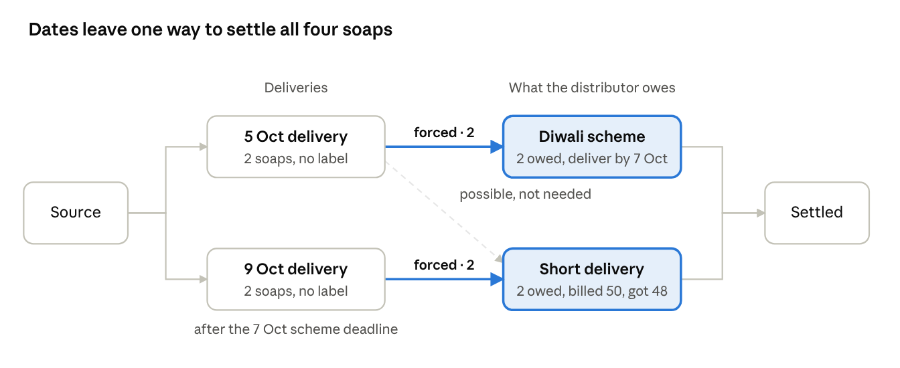
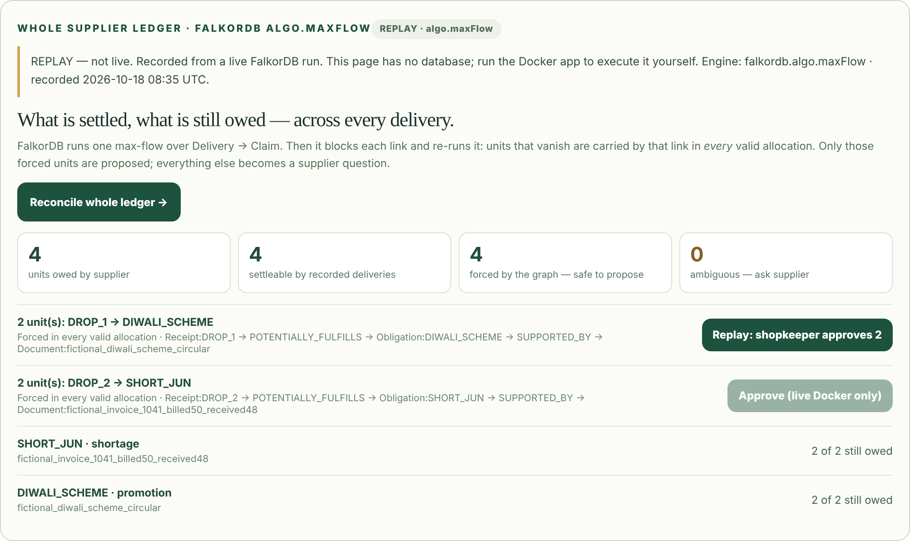
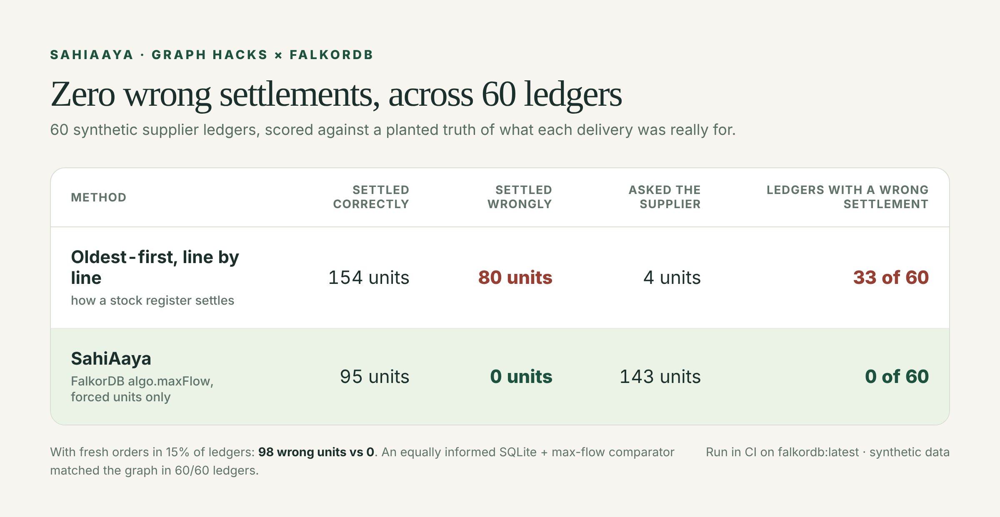
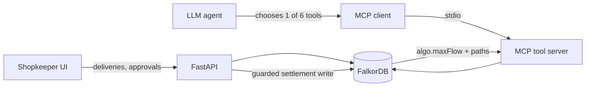

<div align="center">

# SahiAaya — Bill vs Box. Promise vs Proof.

**An AI agent that tells a small shop exactly which supplier promise each delivery settled — and asks instead of guessing when the evidence can't decide.**

Built on **FalkorDB** for Graph Hacks (Oct 15–18, 2026) · Track **01 · Agents That Act on Connected Data** · Track **02 · Agent Memory and Coordination**

[**Live preview**](https://sahiaaya-graphhacks.vercel.app/) · [**Blog post**](https://medium.com/@aadi.n.harale/bill-vs-box-we-taught-an-ai-agent-which-promise-a-delivery-kept-and-when-to-say-i-dont-know-3f09d796db5a) · [**Run it locally**](#run-it-yourself-docker) · [**How it works**](#how-it-works--for-engineers)

</div>

---

## The problem in 30 seconds

A kirana shop in Pune is billed for **50 soaps but receives 48**. The distributor promises **2 replacements**. The shop has also earned **2 free soaps** under a Diwali scheme, deliverable by 7 October. So the distributor owes **4 soaps for two different reasons**.

Then two unlabelled deliveries arrive: **2 soaps on 5 October, 2 soaps on 9 October**. Which promise did each one keep?

A stock register settles one line at a time. It gives the first delivery to the oldest claim (the shortage), strands the second, and leaves the scheme looking unpaid. Write "settled" on the wrong line and a real debt quietly disappears. Kirana stores held about 91% of India's grocery market in 2025 ([Redseer](https://redseer.com/reports/why-indias-mass-grocery-still-leans-on-kirana-stores/)), and most of these ledgers live in notebooks and WhatsApp.

## What SahiAaya does



1. **Remember everything as a graph.** Every bill, delivery, promise, scheme and supplier message becomes connected nodes in FalkorDB.
2. **Reconcile the whole ledger at once.** One `algo.maxFlow` call finds how many delivered units can settle open claims without counting anything twice.
3. **Propose only what is forced.** For each delivery→claim link, SahiAaya blocks it and re-runs the flow. If units disappear, every valid answer needs that link — so it is safe to propose. Here: the 9 October soaps arrived after the scheme deadline, so they can only be the shortage, which forces the 5 October soaps onto the scheme.
4. **Ask when it can't prove.** If either answer would work, it proposes nothing and drafts one precise question for the supplier.
5. **The shopkeeper approves.** Nothing is settled without a tap from the owner, and every number links back to the documents that justify it.



## Does it work?



On 60 synthetic ledgers scored against a planted truth, a line-by-line rule settled **80 units against the wrong claim**; SahiAaya settled **zero** wrongly and turned the uncertain rest into supplier questions. Measured in CI on `falkordb:latest` with the real `algo.maxFlow`.

<details><summary>Exact figures, method, and an honest comparison with SQL</summary>

<!-- BENCHMARK-TABLE -->
| Setting | Method | Units settled correctly | Units settled **wrongly** | Units left as supplier questions | Cases with any wrong settlement |
| --- | --- | --- | --- | --- | --- |
| Every delivery settles a claim (238 units, 60 cases) | Per-row FIFO | 154 | 80 | 4 | 33/60 |
| Every delivery settles a claim (238 units, 60 cases) | **SahiAaya graph** | 95 | 0 | 143 | 0/60 |
| Some cases also hold a fresh order (15%) (284 units, 60 cases) | Per-row FIFO | 171 | 98 | 15 | 40/60 |
| Some cases also hold a fresh order (15%) (284 units, 60 cases) | **SahiAaya graph** | 116 | 0 | 168 | 0/60 |

Engine: `falkordb.algo.maxFlow` on `falkordb:latest` in GitHub Actions (seed 11; the CI job fails if the engine falls back to Python). Graph proposals equal the equally informed SQL comparator in 60/60 cases in both settings. Reproduce: `python -m scripts.benchmark --cases 60 --noise 0.15 --live`.

Honest reading:
- SahiAaya does **not** settle more units than a FIFO rule. It settles **only correct ones** and turns the rest into targeted supplier questions.
- An **equally informed** comparator — the same rows in SQLite plus the same max-flow maths in Python — reproduces the graph's proposals exactly. The claim is that the graph computes this natively, with traversable provenance, beside the agent's memory. It is **not** that SQL cannot.

</details>

## Try it

**In the browser (no install):** open the [live preview](https://sahiaaya-graphhacks.vercel.app/) → **Enter your own case** → click **Load demo: two unlabelled drops (forced)**. The page has no database, so it replays a real FalkorDB run and labels it **REPLAY**. Then try **Load demo: symmetric drops (ambiguous)** to watch it refuse to guess.

### Run it yourself (Docker)

```bash
git clone https://github.com/aadi-harale/graphhacks.git && cd graphhacks
docker compose up -d --build
```

Open http://localhost:8000 and click the same two demo buttons; this time FalkorDB computes everything live, and **Shopkeeper approves** writes a real settlement. The Track 01 agent (**Investigate with agent**) also needs a model key: see [docs/REAL_MODEL_SETUP.md](docs/REAL_MODEL_SETUP.md).

```bash
docker compose exec app pytest -q                                          # unit tests
docker compose exec -e RUN_FALKOR_TESTS=1 app pytest -v tests/test_ledger.py # live graph tests
docker compose exec app python -m scripts.benchmark --cases 60 --noise 0.15 --live
```

---

## How it works — for engineers



The model only chooses tools; it never writes Cypher, contacts a supplier, or settles. Python checks versions and quantities, the graph computes what is forced, and only the shopkeeper approves.

**Where things live:**

| Path | What it is |
| --- | --- |
| `app/ledger.py` | Whole-ledger reconciliation: `algo.maxFlow`, forced-unit test, guarded settlement |
| `app/flow.py` | Reference max-flow + FIFO baseline used by the fallback, SQL comparator and benchmark |
| `app/resolve.py` | Case intake and eligibility edges; per-delivery investigation |
| `app/track1_mcp.py`, `app/track1_mcp_loop.py`, `app/track1_agent.py` | MCP tool server, MCP client loop, tool catalog |
| `app/static/index.html` | The shopkeeper UI (and the labelled replay on the preview) |
| `scripts/benchmark.py`, `scripts/record_ledger_replay.py` | Benchmark; replay recorder |
| `tests/test_ledger.py` | Forced-unit proof by brute force, live-graph tests, MCP transport test |

### Why FalkorDB is essential

Take FalkorDB out and SahiAaya cannot reconcile, explain or settle anything.

| Capability | How the graph does it |
| --- | --- |
| Reconcile the whole ledger | `algo.maxFlow` over `LedgerSource → Receipt → Obligation → LedgerSink` (`LEDGER_FLOW` edges) |
| Prove an allocation is forced | Block one receipt→claim edge, re-run `algo.maxFlow`; the drop is the units that edge carries in **every** maximum allocation |
| Explain every number | Path `Receipt → POTENTIALLY_FULFILLS → Obligation → SUPPORTED_BY → Document` |
| Refuse contradictions | A receipt with conflicting active `ResolveStatement`s gets zero flow capacity → `DISPUTE` |
| Settle safely | One guarded Cypher write: versions, eligibility, no contradicting statement, retailer approval — or nothing |
| Remember | Cases, statements, drafts and approvals persist; reopen a case days later and the agent resumes from the graph |

**The guarantee.** For edge *e*, forced(*e*) = F − F(*e* blocked), where F is the max flow. Every maximum allocation carries at least forced(*e*) on *e*, and the bound is tight. So when every recorded delivery really was meant to settle an open claim, a forced proposal can never contradict the truth. `tests/test_ledger.py` checks this by brute force on 150 random networks.

### Graph model

```
(:ResolveCase)-[:HAS_RECEIPT]->(:ResolveReceipt {qty, available, received_on, confirmed, version})
(:ResolveCase)-[:HAS_OBLIGATION]->(:ResolveObligation {kind, original, remaining, eligible, deliver_by, version})
(:ResolveObligation)-[:SUPPORTED_BY]->(:ResolveDocument {ref})
(:ResolveReceipt)-[:POTENTIALLY_FULFILLS]->(:ResolveObligation)   // date, unit and scheme-window checks
(:ResolveStatement {target_id, reference, active})-[:ABOUT]->(:ResolveReceipt)
(:LedgerSource)-[:LEDGER_FLOW {flow_cap}]->(:ResolveReceipt)-[:LEDGER_FLOW {flow_cap}]->(:ResolveObligation)-[:LEDGER_FLOW {flow_cap}]->(:LedgerSink)
(:ResolveAllocation {qty, proof})-[:FROM]->(:ResolveReceipt), -[:SETTLES]->(:ResolveObligation)
(:ResolveApproval)-[:CONFIRMS]->(:ResolveAllocation)
(:ResolveFollowUp {action, question, status})-[:FOR_RECEIPT]->(:ResolveReceipt)
```

`flow_cap` is derived from graph facts on every reconcile. It is never a business fact. `algo.maxFlow` accepts a single relationship type, so the network uses one `LEDGER_FLOW` type; each receipt→claim `LEDGER_FLOW` edge mirrors a `POTENTIALLY_FULFILLS` eligibility edge. The original preset walkthrough (`app/graph.py`) uses an older `Receipt/Obligation/Allocation` schema in a separate graph.

### The Cypher the product depends on

The core algorithm call (`app/ledger.py`, `Q_MAXFLOW`):

```cypher
MATCH (src:LedgerSource {tenant:$tenant,case:$case}),(snk:LedgerSink {tenant:$tenant,case:$case})
CALL algo.maxFlow({sourceNodes:[src], targetNodes:[snk], capacityProperty:'flow_cap',
                   relationshipTypes:['LEDGER_FLOW']})
YIELD edges, edgeFlows, maxFlow
UNWIND range(0, size(edges)-1) AS i
WITH edges[i] AS e, edgeFlows[i] AS units, maxFlow
WITH startNode(e) AS a, endNode(e) AS b, units, maxFlow
WHERE a:ResolveReceipt AND b:ResolveObligation
RETURN a.id, b.id, units, maxFlow
```

Eligibility edges are created at intake (`app/resolve.py`):

```cypher
MATCH (c:ResolveCase {tenant:$tenant,id:$case})-[:HAS_RECEIPT]->(r:ResolveReceipt {id:$id})
MATCH (c)-[:HAS_OBLIGATION]->(o:ResolveObligation)
WHERE o.eligible=true AND o.created_on <= r.received_on AND r.unit=c.unit
  AND (coalesce(o.deliver_by,'')='' OR r.received_on <= o.deliver_by)
CREATE (r)-[:POTENTIALLY_FULFILLS]->(o)
```

Also in `app/ledger.py`:
- `Q_CAPS_RECEIPTS` — supplier attribution narrows edges; conflicts zero the receipt.
- `Q_BLOCK_EDGE` — the forced-unit test.
- `Q_PATH` — the evidence path.
- `Q_APPROVE_FORCED` — the guarded settlement write.

The per-receipt investigation queries are in `app/resolve.py` and `app/track1_agent.py`.

### The agent (Track 01) and its memory (Track 02)

The model chooses among six bounded tools. A real MCP stdio `ClientSession` carries each call to a FalkorDB tool host (`app/track1_mcp.py`):

| Tool | What it does |
| --- | --- |
| `list_case_receipts` | All deliveries in the case |
| `investigate_receipt` | Connected claims and the authoritative per-receipt decision |
| `trace_claim_evidence` | Receipt → claim → document paths and supplier statements |
| `inspect_cross_delivery` | One claim across every linked delivery and allocation |
| `reconcile_ledger` | **`algo.maxFlow` over the whole ledger: forced, ambiguous, still owed** |
| `create_followup_draft` | The only write: an internal, policy-checked draft question |

The model cannot write Cypher, contact a supplier, or settle. Settlement is a separate, retailer-approved, guarded write.

**Track 02 coverage:**
- **Episodic memory:** statements, follow-up drafts and approvals are versioned graph events.
- **Semantic memory:** claims and scheme terms.
- **Procedural memory:** eligibility rules encoded as graph edges.
- **Persistence:** reopen a case by ID after a refresh.
- **Handoff:** the shop assistant logs deliveries; the owner approves later from the same graph state.
- **Isolation:** user-entered cases live in their own graph (`sahiaaya_resolve`), apart from the resettable preset demo.

---

## Verification status

| Claim | Status |
| --- | --- |
| Ledger reconciliation, forced-unit proofs, conflicts, guarded approval | **Tested** on live FalkorDB (`tests/test_ledger.py`) |
| `algo.maxFlow` runs on `falkordb:latest` | **CI-checked**: the job fails if the engine falls back to Python |
| MCP transport incl. `reconcile_ledger` | **Tested** with injected tool choices over a real stdio session |
| Benchmark vs FIFO and equally informed SQL | **Run** on live graph; see Results |
| Real LLM choosing tools on unfamiliar cases | **Partly verified.** `anthropic/claude-haiku-5.5` (OpenRouter), real MCP, live FalkorDB in GitHub Actions: 3 of 3 completed runs passed all six checks (unattributed → `ASK_SUPPLIER` ×2, supported → `REVIEW_SETTLEMENT`), and the model called `reconcile_ledger` on its own. The other 4 scenarios stopped at the provider before any tool call (likely credit). Script: `scripts/live_model_gate.py` |
| Real suppliers, invoices, payments | **None.** All data is synthetic |

## Limitations

- **Forced proposals assume each recorded delivery was meant to settle an open claim.** A fresh order recorded in the case could be mis-read. Every proposal therefore still needs the shopkeeper's approval. The benchmark's `noise` setting adds such fresh orders on purpose.
- **The forced-unit test temporarily edits one derived capacity per edge.** This runs under a process lock. It is fine for a local demo; production would compute on a snapshot.
- **No real identity or authentication.** Local mutation endpoints have neither. Do not expose them publicly (see [SECURITY.md](SECURITY.md)).
- **Synthetic data only.** No pilot, recovered money or real supplier was involved.

## AI use disclosure

AI coding assistants (Claude, among others) helped draft design, code, tests and docs. The team reviewed the graph model, queries and safety rules and validated them with executable tests. The max-flow modelling, the forced-unit rule and its brute-force test are explained in `app/flow.py`, `app/ledger.py` and `tests/test_ledger.py`.

More: [docs/TRACK01_IPHONE_AGENT.md](docs/TRACK01_IPHONE_AGENT.md) · [docs/NEW_CASE_WORKFLOW.md](docs/NEW_CASE_WORKFLOW.md) · [docs/FINAL_SUBMISSION_AUDIT.md](docs/FINAL_SUBMISSION_AUDIT.md) · [BUILD_GATES.md](BUILD_GATES.md) · [CLAUDE.md](CLAUDE.md)
